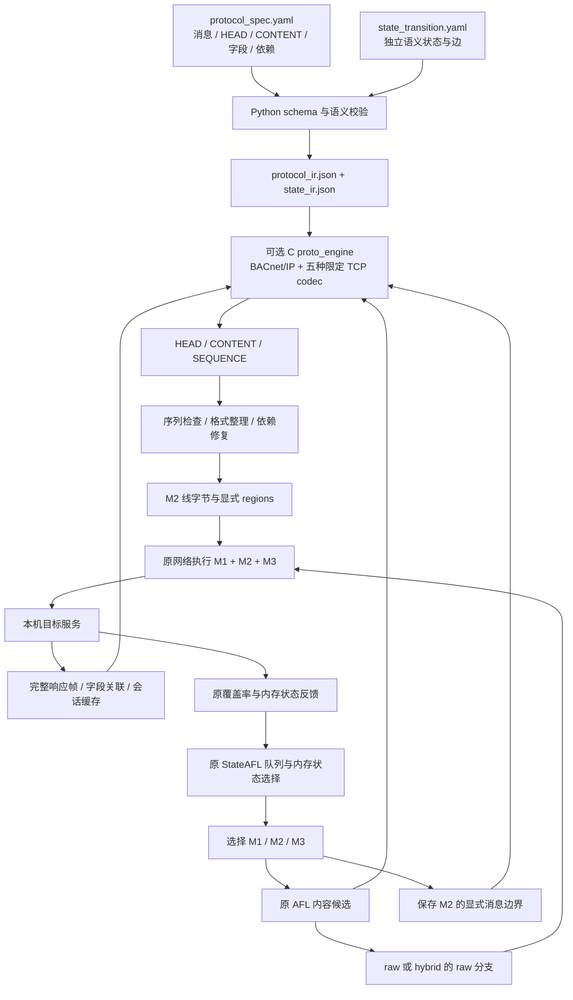

# 可选协议描述路径的架构

在线增量改动见 [StateAFL 集成契约](online-directed-integration.md)：所有接收路径
统一向 runtime 提供新增响应，发送绑定原子提交，并提供可选的按内存状态学习的
变异层调度。当前改动仅经过静态审查，未重新构建或运行。

新增 [C 原生本地检查入口](native-inspection.md)：通用 JSON 布局解码、约束校验及双状态观测管理直接链接进 afl-fuzz，在 main 检查模式完成后退出，不进入候选、目标执行或反馈调度。本轮未构建或运行，不表示在线通用变异融合完成。

早期独立 Python 解码、字段编辑和观测分析原型及旧模板已移除。当前[布局解释](generic-offline-decoder.md)和[双状态观测报告](offline-state-relation.md)使用 C 本地检查入口；字段编辑尚无 C 替代。本轮只做源码清理及静态审阅，没有验证构建或运行。下面继续描述现有 ICP-IR v1 在线路径，六套旧模型和 codec 尚未迁移到通用布局。

本次扩展在现有 StateAFL LLVM 18 版本上增加离线描述编译器和可选协议运行时。StateAFL 原有的覆盖率、内存快照、TLSH/MVPTree、状态选择、队列和 replay 路径继续承担反馈与调度职责。协议语义状态是独立上下文，不写入内存状态命名空间。

## 离线层

[proto_spec_compiler.py](../tools/proto_spec_compiler.py) 安全加载两份描述，执行 JSON Schema 及跨对象检查，生成确定性 JSON 和验证摘要。字段来源和支持级别随 IR 保留；描述中的 source URL 是证据引用，不会触发网络请求。可执行依赖类型由白名单限制，普通文本不能调用代码。语法及能力边界见 [protocol-description-language.md](protocol-description-language.md)。

每个协议目录保存源 YAML、编译 JSON、字段证据和请求 fixture。BACnet/IP、Modbus TCP、IEC104、MMS/TCP、EtherNet/IP/CIP 和 OPC UA TCP 的声明 profile 均有有界 C codec；完整标准和安全/会话功能的排除项仍由各描述包明确列出。

非 BACnet 描述编译通过 [native_protocol_codecs.py](../tools/native_protocol_codecs.py) 调用同一组 C validator/locator，检查完整 fixture、实际字段范围和服务类别。该 helper 每个编译器进程在临时目录构建一次共享库，需要 C11 编译器（`CC` 或 `cc`）、`protocol_codecs.h` 和五个 `protocol_codec_*.c` 源文件。StateAFL 直接链接 C codec，候选变异、发包和收包期间不运行 Python。独立 fixture checker 仍用于交叉检查，不能以共用 validator 代替独立证据。

## 在线候选路径

`--protocol-spec` 和 `--state-spec` 必须成对出现。只有显式启用时才创建 `proto_engine`、协议日志和协议统计。模型须声明实际可用的 runtime 支持；BACnet 使用 UDP，五种新增 codec 使用 TCP。传输不匹配在目标启动前拒绝；当前禁止与 legacy `-P` 或 `AFL_POST_LIBRARY` 共用消息边界。

原 `fuzz_one` 继续选择队列及待变异的 M2，保留 M1 前缀和 M3 后缀。`protocol_capture` 额外保存 M2 的 LE32-length replay 记录；AFL 的输入和内容变异仍然使用不带长度前缀的线字节。`common_fuzz_stuff` 根据模式选择 raw 或结构化路径。结构化路径在 `proto_mutate` 中选层、按消息权重选记录，生成候选并检查依赖和序列。

runtime 输出是带 LE32 长度的记录；适配层解包为线字节和精确 `region_t`，再进入原 M2 替换逻辑。长度前缀仅用于磁盘/模块间边界，不作为网络 payload 发送。结构化 SEQUENCE 可以改变 M2 消息数，因此该分支不会按旧 `max_seed_region_count` 合并多条结构化消息；适配层另检查包含 M1/M3 和 replay 前缀的完整序列不超过 MAX_FILE。

适配层把已有 M1 请求前缀交给 `proto_set_prefix`，按模型边和声明响应边计算 M2 的语义起点。它只模拟状态，不伪造 M1 响应值；实际 session/channel/token 等绑定来自本次连接的响应。无法识别或无法按图推进的前缀会拒绝结构化候选。M1/M3 的选择、保留及重放仍由 StateAFL 原逻辑负责；当前不搜索或重建任意会话 preamble。

## 格式、依赖与会话

[protocol_runtime.c](../protocol_runtime.c) 包括受限 JSON IR 读取、codec 分派、请求序列变异、依赖求值、会话标量缓存和统计。BACnet codec 检查 BVLC、可选 NPDU 地址、未分段 APDU 和 BACnet LVT 标签边界；它不把 BACnet 标签当作 BER。五个独立 TCP codec 负责对应 envelope、内层长度/计数、服务体、精确字段切片及 TCP 帧边界。IR 标量支持完整 `uint64` 范围。

构造候选时先按 codec 重组，再按依赖图修复本地长度/计数/偏移/校验和及可解析的缓存绑定，最后验证并序列化。CONTENT 只替换 codec 支持的叶字段；不能把 AFL 字节直接复制为任意 CIP、UA 或 BER 容器。未支持的 opaque 容器明确拒绝。MMS 叶替换会重新计算祖先 BER 和 ISO session 长度，允许短/长长度头以及 INTEGER 编码宽度改变。Modbus 的重复元数据仅允许 codec 已实现的 FC0F/10 data/count 布局，不是通用 repeat 执行器。

该过程在临时模拟会话执行，结束时恢复 live cache。每次 `send_over_network` 开始调用 `proto_session_begin` 清除真实会话缓存、pending/outstanding 集合及 TCP 接收缓存。

结构化发包前使用 `proto_before_send` 处理会话绑定，接收新响应字节后用 `proto_after_response` 更新字段缓存和相关响应计数。TCP 接收缓冲按 MBAP/APCI/TPKT/encapsulation/UACP 长度拆帧，等待分片余部并逐条处理合并响应；只在完整帧通过 codec、字段范围和已声明关联约束后缓存值。TCP 字节流拆帧不意味着支持 OPC UA 多 chunk 或其他被排除的协议级分段。

消息标记区分本次结构化 M2 与继承的 M1/M3；后者可能包含 raw 消息，解析失败时按原样发送。故意破坏的各协议长度不能在发包前重新修复。缓存键包含 engine、消息和字段；当前保存最近的标量及 pending 请求，不是通用多事务数据库，也不执行 guard/action 字符串。

## 两条状态通路

| 通路 | 来源及职责 | 输出 |
| --- | --- | --- |
| StateAFL 内存状态 | LLVM 18 插桩的目标长期对象快照，TLSH/MVPTree 推断，原状态/种子选择 | 原 IPSM 图、内存状态 ID 和队列注解 |
| 协议语义状态 | 用户描述的状态和消息边；runtime 会话、请求序列检查及响应观察 | 独立 `protocol_semantic_state` 和协议日志/统计 |

协议模型中的 `ready`、`pending` 等名字不代表 StateAFL 已观察到相同数量的内存状态。语义状态图可达不证明目标行为正确；非零 invoke 关联计数也不证明覆盖增加。两种反馈应分别检查和报告。

## 日志、关闭行为和验证

`protocol_mutations.jsonl` 记录成功候选、拒绝及显式 fallback；`protocol_stats.json` 记录 runtime 层计数、响应、关联响应和独立语义状态。`fuzzer_stats` 保留原反馈指标，并在启用时补充 raw/structured/rejection 计数。候选成功、实际网络执行、响应、覆盖发现属于不同阶段，应按相应产物解释。

没有提供描述文件时，协议 engine 不创建，候选继续走现有 AFL 路径。新增模块被链接进 fuzzer 不等于启用结构化变异。generic replay 读取新增了显式小端解码及截断/零长度检查，保存路径清空旧文件并显式写入 LE32 长度。共享网络层确保每条 UDP 消息一次发送，使用 65536 字节接收缓冲并检测截断；这些共享路径改动需要同时验证关闭功能的兼容性。

LLVM 18 工具链、New PM 插桩及原内存运行时保持现有移植设计；本次协议层不引入替代 LLVM 工具链。[LLVM18_MIGRATION_AUDIT.md](../LLVM18_MIGRATION_AUDIT.md) 和 [LLVM18_TEST_REPORT.md](../LLVM18_TEST_REPORT.md) 是既有证据，不能替代本次修改后的回归。当前结果和未完成项见 [implementation-review.md](implementation-review.md) 及 [BACnet 集成验证](bacnet-integration-test.md)。

## 模板与按描述目录启动

用户先参考 `protocols/templates/*.template.yaml` 的统一结构，或用 `tools/init_protocol_spec.py --base <协议配置> --output-dir <目录>` 生成已经填入真实协议字段的描述包。模板是填写起点，schema 是检查规则，各协议目录是实例；三者不混用。生成器不使用 YAML 别名，避免一处字段修改联动另一条消息。

`tools/run_protocol_campaign.py --spec-dir <目录> -- <afl-fuzz参数>` 每次读取两份 YAML，校验字段/依赖/状态，重新编译对应 IR，然后使用 `os.execv` 把控制权交给原 afl-fuzz。无效配置或仅静态支持的协议在目标启动前失败，不使用旧 IR 继续执行。手工编译后传入两个原 CLI 参数的方式仍然可用。

当前六种协议的统一描述均可生成、校验并选择已有有界 C codec。匹配使用方向、codec 服务类别及字段约束；等价 Modbus 示例别名记录在 validation 中。模板填写不自动实现未支持的服务或容器。

真实工业协议目标的既有集成证据仍来自 BACnet Stack。新增 [multicodec_server.c](../tests/protocol/fixtures/multicodec_server.c) 是仪器化 C 功能夹具，通过 [multicodec_integration.py](../tests/protocol/multicodec_integration.py) 检查五种 TCP 路径、实际字段变化和响应绑定；它不是这五种协议的工业服务器或独立标准符合性实现。最终测试结果以当前运行产物为准，不由架构描述宣告全部通过，也不据此宣称吞吐或覆盖收益。
