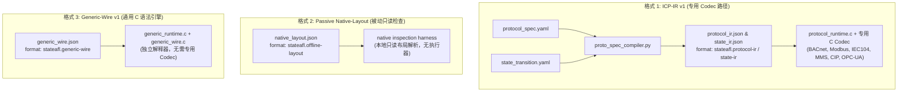

# 三种协议描述格式能力矩阵与识别边界

本文档建立 StateAFL 中三种协议描述格式的正式能力对比矩阵、识别边界与字段分类契约（对应治理计划中的 **G01** 项）。

---

## 1. 架构定位与格式标识

StateAFL 系统内存在三种不同的描述格式，服务于不同的执行路径与验证目标。**严禁将三种格式混淆为同一种语言**。

| 格式分类 | 顶层 `format` 声明 | 版本标识 | 主要目标 | 执行入口 |
| --- | --- | --- | --- | --- |
| **格式 1: ICP-IR v1** | `stateafl.protocol-ir` / `stateafl.state-ir` | `ir_version: 1` | 驱动具备预编译专用 C Codec 的已有工业协议。统一配置结构，编码能力依赖 Codec。 | `--protocol-spec` + `--state-spec` |
| **格式 2: Passive Native-Layout** | `stateafl.offline-layout` | `version: 1` | 本地内存快照与离线报文的只读结构断言与字段检查，不启动网络目标。 | 离线测试工具 / 单元测试 |
| **格式 3: Generic-Wire v1** | `stateafl.generic-wire` | `version: 1` | 纯 C 实现的自包含通用报文解释器、变异器和状态执行器，无需专用 Codec。 | `--generic-spec` |

---

## 2. 十个维度的能力对比矩阵

| 评估维度 | 格式 1: ICP-IR v1 (专用 Codec) | 格式 2: Passive Native-Layout | 格式 3: Generic-Wire v1 (通用解释器) |
| --- | --- | --- | --- |
| **1. 语法形式 (Syntax)** | JSON（由 YAML 离线编译产出）；必须成对提供 protocol_ir 与 state_ir。 | 独立 JSON；描述单个根结构 (`packet` / `struct`)。 | 独立自包含 JSON；同时包含 transport, framing, messages, states, limits。 |
| **2. 解析能力 (Parsing)** | 依赖协议专用 C Codec（支持 BER/ASN.1, TPKT, CIP 封装, OPC UA 二进制等复杂结构）。 | 支持固定偏移、bits 位域、固定/引用 repeat 容器，用于只读验证。 | 纯通用顺序 struct：uint 标量 (8/16/24/32/64-bit) 及动态/固定 bytes 切片。 |
| **3. 编码能力 (Encoding)** | 依赖专用 C Codec 重新组装报文，自动修复校验和及长度。 | **无**（被动只读，不支持编码）。 | 纯 C 原生线格式组装；自动派生字段重算与固定字段保护。 |
| **4. 变异层级 (Mutation)** | 支持 HEAD（报头字段替换）、CONTENT（协议负载变异）、SEQUENCE（状态序列编辑）。 | **无**（只读检查，不支持任何在线变异）。 | 支持 HEAD（语法树叶字段变异）、CONTENT（未约束负载字节变异）、SEQUENCE（序列增删改）。 |
| **5. 依赖与派生 (Dependencies)** | 支持 copy, bind, length, correlation, sequence 声明式依赖。 | 支持字段间长度与计数的引用声明（只读校验）。 | 支持 `size_of($message)`、字段字节长度、算术偏移 `add`，前向/后向字段派生。 |
| **6. 状态模型 (State Model)** | 预测状态机迁移图；M1 前缀驱动；**预测状态与目标内存状态严格解耦**。 | **无状态机**（单次报文/快照评估）。 | 确定性状态迁移图；请求/响应触发状态边；预测状态与内存状态严格隔离。 |
| **7. 传输分帧 (Framing)** | 由各 Codec 内部或 replay 记录处理；TCP 流式合并或 UDP 独立数据报。 | **无传输概念**。 | 显式声明 `framing`：TCP 支持 length_field（offset/width/endian/add），UDP 严格保证 datagram 边界。 |
| **8. 响应关联 (Correlation)** | 运行时维护 pending 队列，按 transaction/invoke/request ID 动态关联。 | **无关联概念**。 | 显式 `response_matches`：按声明的整数相等条件关联请求与响应。 |
| **9. 资源限制 (Limits)** | 32 消息、32 字段、16 状态、64 迁移、1 MB 最大单报文。 | 1 MB 文件上限，递归深度上限。 | 32 消息、64 字段、16 状态、64 迁移、1 MB 最大线报文。 |
| **10. 在线资格 (Online Eligibility)** | 仅限已编译专用 C Codec 的 6 种工业协议；配置错误立即拒绝。 | **严格 Offline-only**；严禁传入 AFL-Fuzz。 | 严格检查 `online: true`；目前仅 Modbus FC03 单寄存器具备在线资格，其余 5 种 profile 显式 `online: false`。 |

---

## 3. YAML 模板字段分类契约

在现有 YAML 模板（`protocols/templates/protocol_spec.template.yaml` 与 `state_transition.template.yaml`）中，字段根据其在运行时的真实语义被划分为四类。**不允许将“能写入文件”解释为“运行时执行”**。

### A 类：运行时执行字段 (Execution Fields)
这些字段由编译器转换为 IR，并在 C 运行时实际影响解析、编码、变异或状态迁移：
* `id`：报文/字段/状态唯一标识。
* `role`：字段所属层级（`head` 或 `content`），决定变异分层。
* `mutability`：字段可变性（`fixed` 保护不被破坏，`fuzzable` 允许变异，`runtime_bound` 动态重写）。
* `type` / `width` / `endian`：整数或字节切片的物理布局。
* `min` / `max`：整数变异时的合法范围边界。
* `values`：枚举变异候选值池（**注：不作为解析时的封闭值域过滤**）。
* `strategies`：变异算子选择（如 `enum`, `boundary`, `bitflip`）。
* `dependencies`：明确支持的操作（如 `length`, `copy`, `bind`, `correlation`）。
* `from` / `to` / `message` / `response`：状态迁移边三元组。

### B 类：校验元数据字段 (Validation Metadata)
这些字段在离线静态检查、审计及 IR 编译器校验阶段使用，运行时引擎不直接执行：
* `protocol_id`：协议名称标识，用于跨文件一致性与 Bundle 校验。
* `version` / `ir_version`：描述文件版本号。
* `scope`：文档化声明的服务支持范围与排除项。
* `evidence` / `source`：对应官方规范标准章节或公开实现链接。
* `bundle_digest` / `sha256`：文件完整性签名与双文件一致性散列。

### C 类：说明与注释字段 (Informational / Comments)
仅供工程师阅读或生成文档，编译器与运行时均完全忽略：
* `description`：报文、状态或字段的人类可读语义解释。
* `doc` / `references`：外部文档链接。
* 状态的 `meaning`：状态的物理业务含义描述。

### D 类：明确拒绝/未实现字段 (Explicitly Unsupported / Rejected Fields)
如果用户在描述中尝试使用以下字段，静态检查器必须直接**显式报错并拒绝执行**，禁止静默忽略或伪实现：
* `guard`：条件表达式消歧（C 运行时每个 `(from, message)` 边必须唯一，不执行 guard 表达式）。
* `actions`：任意脚本或副作用动作（动态绑定必须通过明确的 `dependencies` 规则完成）。
* `when`：条件字段判断（C 运行时不支持动态条件布局）。
* `dynamic_array` / `repeat`（除 Modbus FC0F/10 专用实现外）：未定义上界的变长数组。
* `ber_indefinite`：ASN.1 不定长编码。
* `script_hook` / `code_eval`：任何形式的代码嵌入或求值。

---

## 4. 跨格式加载隔离与拒绝规则

为防止用户将错误的配置文件传递给不匹配的运行时引擎，C 加载器执行以下强制校验：

1. **`proto_load` 边界保护**：
   * 严格要求 IR 文件包含 `ir_version: 1`。
   * 若 IR 文件声明了 `format` 属性，必须为 `stateafl.protocol-ir` 或 `stateafl.state-ir`。
   * 若检测到 `format: stateafl.generic-wire` 或 `format: stateafl.offline-layout`，立即输出 `incompatible specification format: ... (expected ICP-IR v1)` 并终止。

2. **`gr_load` 边界保护**：
   * 严格要求描述文件根对象包含 `format: "stateafl.generic-wire"` 及 `version: 1`。
   * 若检测到 `format: stateafl.offline-layout`、`stateafl.protocol-ir` 或缺少合法头，立即输出 `incompatible specification format` 错误并终止。
   * 严格检查 `online: true`；若为 `false`，输出 `description is offline-only` 并拒绝启动在线模糊测试。
