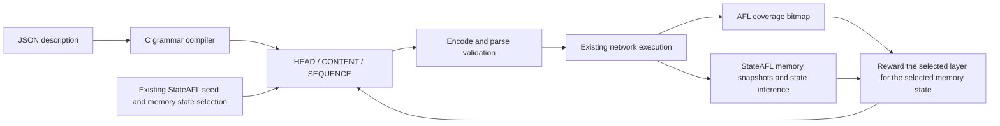

# Description-driven C mutation

`--generic-spec FILE` loads a `stateafl.generic-wire` version 1 JSON package
directly in StateAFL. `generic_wire.c` implements the bounded wire interpreter,
parser, encoder and field mutator. `generic_runtime.c` implements replay
records, message selection, sequence edits, response framing and correlation.
Neither module selects behavior by protocol name, invokes Python, loads
protocol-specific codecs or executes expressions as code. The existing
`--protocol-spec`/`--state-spec` route remains a separate legacy implementation.

Adding a protocol expressible with the primitives below requires a new JSON
description and replay seeds. The seventh-protocol acceptance fixture
demonstrates that path. Protocols requiring BER, conditional structures,
arrays, bitfields or session bindings beyond these primitives still require
general language extensions. The six industrial packages are scoped migration
subsets; see [their status](generic-wire-profile-scope.md) before use.



## Package structure

Use [fictional_protocol.json](../tests/generic-wire/fictional_protocol.json)
as a complete minimal example. The required top-level keys are `format`,
`version`, `protocol_id`, `transport`, `online`, `framing`, `messages`,
`states` and `limits`. `limitations` and `unsupported` document migration
gaps. Unknown executable keys are rejected. `online:false` fails at startup.

Each message declares an ID, `direction` (`request` or `response`), a positive
selection `weight`, a complete `example_hex`, and a `grammar`. The runtime
compiles and parses each example at load time. Request and response matching
are separate; a wire message matching multiple grammars in its direction is
rejected. Constants should distinguish message families explicitly.

A grammar is `{"kind":"struct","fields":[...]}`. Fields appear in wire
order and have unique IDs. The grammar consumes the entire message.

| Property | Executable meaning |
| --- | --- |
| `kind:"uint"` | Unsigned integer, `width` 1..8 bytes, explicit `byte_order:"big"` or `"little"`. |
| `kind:"bytes"` | Byte string with constant `length`, final `"rest"`, or a reference to an earlier unsigned length field. |
| `min`, `max` | Inclusive value bounds for integers; byte-count bounds for byte strings. |
| `role:"fixed"` | Preserve `expected` integer or `expected_hex` bytes exactly. |
| `role:"head"` | Integer selected by HEAD mutation. |
| `role:"content"` | Integer or bytes selected by CONTENT projection. |
| `role:"derived"` | Recompute an integer from an encoded byte size. |
| `values` | HEAD mutation suggestions inside integer bounds; these are not a parse-time enum restriction. |
| `derived` | `{"op":"size_of","target":"$message","add":-3}`, or a named field target. Counts encoded bytes. |

The byte string reference form is `{"ref":"length_field","add":0}`.
The referenced integer must precede the bytes so parsing can determine its
length. A derived `size_of` target may precede or follow the integer. All
arithmetic and output sizes are checked. A successfully encoded message is
parsed again through the same grammar before it is accepted.

TCP framing is a declared `length_field` with `offset`, `width` (1..4),
`byte_order` and signed `add`: frame bytes = field value + add. Responses may
arrive fragmented or coalesced. UDP uses `{"kind":"datagram"}`. The online
runtime bounds each message at 65,507 bytes and a serialized replay at
StateAFL's `MAX_FILE`. Limits also bound message count and repetitions.

## Three mutation layers and feedback

HEAD selects a declared integer and applies a suggested value, boundary,
bit flip or arithmetic edit. CONTENT projects bytes from the AFL candidate
only into the selected content field. Resizable byte strings repair their
declared size dependencies. Fixed constants and other field values are
preserved. Failed mutation/serialization returns a diagnostic and no output.

SEQUENCE inserts a declared request example, deletes a request, repeats one,
or reorders requests. It operates on `LE32(length) || wire` replay records;
the record prefix is never transmitted. The resulting request path must fit
the declared state graph and sequence budgets. The unchanged M1/M3 sequence
remains under StateAFL's existing selection logic.

`states.initial` names the initial semantic state. Each transition declares
`from`, `message`, `to`, and optionally `response`. Offline sequence checking
projects the declared outcome to decide whether a request sequence is legal.
During live execution a response-bearing transition waits for the actual
matching response. Response `correlate` entries compare integer `field` values
with a `source` field in the named `request`; they never fabricate observed
values. These description states are distinct from StateAFL memory state IDs.
The v1 live executor allows one outstanding response-bearing request per
session; a second send is rejected until the expected response is received.
It does not implement pipelining, retransmission recovery or server-issued
session-value bindings. Sequence message, repetition and byte budgets include
the captured M1 prefix; the integration separately enforces `MAX_FILE` for
the full M1/M2/M3 replay.

`--protocol-schedule adaptive` uses the existing C scheduler for all three
layers. It keys weights by the selected StateAFL memory state, explores every
enabled layer, and rewards new queue entries, memory states, crashes, hangs,
new coverage tuples and newly observed hit-count buckets. A rejected candidate
gets an unsuccessful observation. Coverage credit requires delivery of the
whole structured M2; calibration/replay executions do not choose another
layer or produce duplicate candidate observations. Protocol response states
are not inserted into StateAFL's inferred memory-state graph.

## Running and verification

Build `afl-fuzz`, prepare a replay corpus, and run against an instrumented
target with `--generic-spec FILE --mutation-mode valid --mutation-layers
head,content,sequence --protocol-schedule adaptive`. Use `-E` to enable
StateAFL's memory-state selection. Supply network transport and target
startup/timeout settings appropriate to that target. Omit legacy `-P`.

`valid` preserves the executable grammar constraints, not every semantic
requirement in a protocol standard. `hybrid` also executes ordinary raw AFL
mutations according to `--protocol-ratio`; `raw` bypasses structured mutation.
`near_valid` and `invalid` are rejected at startup for this grammar version.
Explicit `--protocol-fallback` permits raw execution after a rejected edit.

Run file-only C grammar/runtime checks with `make check-generic-wire`.
They use ASan/UBSan and include a new protocol, six profile subsets, malformed
input, size repair, field preservation, state sequencing and TCP correlation.
Run legacy integration regressions with `bash tests/protocol/run_all.sh`.

The bounded loopback acceptance command is:

```sh
python3 tests/generic-wire/run_live.py \
  --output /tmp/stateafl-generic-acceptance --seconds 12 --state-aware
```

This Python process only builds/starts the C target and fuzzer, then reads
saved evidence. The C target independently validates every received packet.
The report requires visible edits from every layer, no raw execution, real
coverage feedback and, with `--state-aware`, real memory-state feedback. It
does not measure an improvement over baseline AFL or establish industrial
protocol conformance. Comparative coverage claims require repeated equal
budget experiments on the intended industrial targets.
