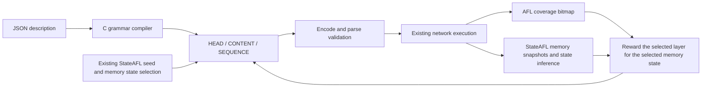

# Description-driven C mutation

`--generic-spec FILE` loads a `stateafl.generic-wire` version 1 JSON package
directly in StateAFL. `generic_wire.c` implements the bounded wire interpreter,
parser, encoder and field mutator. `generic_runtime.c` implements replay
records, message selection, sequence edits, response framing and correlation.
Neither module selects behavior by protocol name, invokes Python, loads
protocol-specific codecs or executes expressions as code. The existing
`--protocol-spec`/`--state-spec` route remains a separate legacy implementation.

Adding a protocol expressible with the primitives below requires a new JSON
description and replay seeds. The seventh-protocol acceptance fixture
demonstrates that path. Protocols requiring BER, conditional structures,
arrays, bitfields or session bindings beyond these primitives still require
general language extensions. The six industrial packages are scoped migration
subsets; see [their status](generic-wire-profile-scope.md) before use.

The existing YAML compiler and `run_protocol_campaign.py` emit and load the old
ICP-IR pair only. `build_generic_wire_profiles.py` is a six-profile fixture
migration, with selected messages, state edges and correlations supplied by its
own fixed tables. It does not translate the old state IR or all dependency
semantics. The passive native-layout format is a third, separate language.
See the [template format comparison](../protocols/templates/README.md).

The diagram shows interfaces, not proof that every StateAFL state reaches
mutation. The current source adds a cooperative message-boundary provider;
without valid provider evidence, regions remain UNKNOWN and cannot locate a
nonzero-state M2. Current authoring improvements and compile-only results are
recorded in [template repair status](template-system-repair-20261104.zh-CN.md).



## Package structure

Use [fictional_protocol.json](../tests/generic-wire/fictional_protocol.json)
as a complete minimal example. The required top-level keys are `format`,
`version`, `protocol_id`, `transport`, `online`, `framing`, `messages`,
`states` and `limits`. `limitations` and `unsupported` document migration
gaps. Unknown executable keys are rejected. `online:false` fails at startup.

The formal editable starter is [generic_wire.template.json](../protocols/templates/generic_wire.template.json).
The [online JSON Schema](../protocols/schema/generic_wire.schema.json) checks
structure, branches and numeric budgets. The [authoring catalog](../protocols/templates/generic_wire_examples/README.md)
adds UDP one-way, UDP request/response and TCP length-framed request/response
examples, exact request-only replay corpora and source-bound manifests.
`tools/generic_template_catalog.py` copies, checks and explicitly refreshes
these managed packages. These static authoring checks do not replace native
wire, reference and state validation, or certify arbitrary external inputs.

Each message declares an ID, `direction` (`request` or `response`), a positive
selection `weight`, a complete `example_hex`, and a `grammar`. The runtime
compiles and parses each example at load time. Request and response matching
are separate; a wire message matching multiple grammars in its direction is
rejected. Constants should distinguish message families explicitly.
The production loader and offline profile checker both cross-parse every
declared example against same-direction grammars and reject example ambiguity.
This moves known example failures to package loading. Neither finite check
proves that two grammars are disjoint for all possible wire values; actual
message matching continues to reject ambiguity.

The offline checker now also applies the native JSON input bounds before
decoding: at most 1 MiB of UTF-8 input, 65,536 nodes including object keys, and
value depth at most 96 with the root at zero. It rejects floating-point and
non-JSON numeric constants, out-of-range integers, duplicate decoded keys and
invalid Unicode scalars. These defensive checks do not extend the wire grammar.

A grammar is `{"kind":"struct","fields":[...]}`. Fields appear in wire
order and have unique IDs. The grammar consumes the entire message.

| Property | Executable meaning |
| --- | --- |
| `kind:"uint"` | Unsigned integer, `width` 1..8 bytes, explicit `byte_order:"big"` or `"little"`. |
| `kind:"bytes"` | Byte string with constant `length`, final `"rest"`, or a reference to an earlier unsigned length field. |
| `min`, `max` | Inclusive value bounds for integers; byte-count bounds for byte strings. |
| `role:"fixed"` | Preserve `expected` integer or `expected_hex` bytes exactly. |
| `role:"head"` | Integer selected by HEAD mutation. |
| `role:"content"` | Integer or bytes selected by CONTENT projection. |
| `role:"derived"` | Recompute an integer from an encoded byte size. |
| `values` | HEAD mutation suggestions inside integer bounds; these are not a parse-time enum restriction. |
| `derived` | `{"op":"size_of","target":"$message","add":-3}`, or a named field target. Counts encoded bytes. |

The byte string reference form is `{"ref":"length_field","add":0}`.
The referenced integer must precede the bytes so parsing can determine its
length. A derived `size_of` target may precede or follow the integer. All
arithmetic and output sizes are checked. A successfully encoded message is
parsed again through the same grammar before it is accepted.

TCP framing is a declared `length_field` with `offset`, `width` (1..4),
`byte_order` and signed `add`: frame bytes = field value + add. Responses may
arrive fragmented or coalesced. UDP uses `{"kind":"datagram"}`. The online
runtime bounds each message at 65,507 bytes and a serialized replay at
StateAFL's `MAX_FILE`. Limits also bound message count and repetitions. Source hard limits are 128
message models, 256 fields per grammar, 64 states, 256 transitions, 16 correlation
rules per message and 64 replay records. Package limits may lower sequence
budgets; model count is not the number of messages allowed in one execution.
The global TCP framing rule applies to request and response examples alike.
The C loader checks that the length field fits inside each complete example
and that its value plus `add` equals the example's byte length. This tightens
loading to match the offline profile checker; v1 has no per-direction framing
override. A custom package previously accepted with differently framed request
examples can now be rejected. This example check does not establish that every
grammar-accepted candidate obeys framing; the grammar must declare the needed
length dependency itself.
Request examples must also fit `limits.max_bytes` including their four-byte
replay prefix. Both loaders reject a package whose request template already
exceeds that budget. Response examples are not replay records and are not
charged against this request-sequence limit.
The host routes each received UDP datagram separately through `gr_after_dgram`
and TCP chunks through `gr_after_stream`. A truncated datagram is diagnostic
input, is not submitted to the runtime as a complete response, and makes the
response observation incomplete. A receive buffer exactly at its byte budget
is not over budget until another byte is actually observed. These error and
boundary changes require execution validation.

## Three mutation layers and feedback

HEAD selects a declared integer and applies a suggested value, boundary,
bit flip or arithmetic edit. CONTENT projects bytes from the AFL candidate
only into the selected content field. Resizable byte strings repair their
declared size dependencies. Fixed constants and other field values are
preserved. Failed mutation/serialization returns a diagnostic and no output.

SEQUENCE inserts a declared request example, deletes a request, repeats one,
or reorders requests. It operates on `LE32(length) || wire` replay records;
the record prefix is never transmitted. The resulting request path must fit
the declared state graph and sequence budgets. The unchanged M1/M3 sequence
remains under StateAFL's existing selection logic.

`states.initial` names the initial semantic state. Each transition declares
`from`, `message`, `to`, and optionally `response`. Offline sequence checking
projects the declared outcome to decide whether a request sequence is legal.
During live execution a response-bearing transition waits for the actual
matching response. Response `correlate` entries compare integer `field` values
with a `source` field in the named `request`; they never fabricate observed
values. These description states are distinct from StateAFL memory state IDs.
The v1 live executor allows one outstanding response-bearing request per
session; a second send is rejected until the expected response is received.
It does not implement pipelining, retransmission recovery or server-issued
session-value bindings. `gr_prepare_send` validates a private session snapshot;
only a fully submitted message permits `gr_commit_send`. Partial or failed
submission requires `gr_cancel_send` before response observation. The compatible
`gr_before_send` convenience API immediately commits and is suitable only when
successful submission is already known, not as a network success signal.

The host now checks M1, new M2 and retained M3 together through the full sequence
validator, including the semantic graph, repeat counts, record counts and
serialized byte budget. Live valid-mode binding failures abort the planned
session. The full replay also obeys StateAFL's `MAX_FILE` bound. This is a
source-level correction to the previous M3 omission, pending execution checks;
it does not validate protocol semantics absent from the grammar.

New generic statistics declare `stats_version:2`. `completed_responses` counts
pending requests completed by their expected response. `correlated_responses`
counts only completions with at least one applicable field equality rule checked
and all applicable rules passing. An expected response without rules can still
complete the request, but increments only `completed_responses`. Neither metric
counts individual field comparisons. Pending and semantic-state behavior is
unchanged by this accounting correction.

Historical statistics without `stats_version` have v1 semantics: their
`correlated_responses` includes completions without field rules. The report
writer distinguishes versions and does not infer field verification from old
counts. Unknown statistics versions remain uninterpreted.

`--protocol-schedule adaptive` uses the existing C scheduler for all three
layers. It keys weights by the selected StateAFL memory state, explores every
enabled layer, and rewards new queue entries, memory states, crashes, hangs,
new coverage tuples and newly observed hit-count buckets. A rejected candidate
gets an unsuccessful observation. Coverage credit requires complete submission
of all planned messages and a complete response observation, in addition to
delivery of the structured M2. The coverage execution ID is frozen before
state-analysis, confirmation or calibration; these internal executions do not
choose another layer or produce duplicate candidate observations. Protocol response states
are not inserted into StateAFL's inferred memory-state graph.
Memory-state discovery is performed only after the ordinary coverage novelty
gate retains a candidate. The memory reward is therefore additional feedback
after that gate, not an independent retention path for memory-only novelty.
Historical loopback evidence attributes every layer observation to state 0;
an injected nonzero-ID harness does not validate natural nonzero-state M2
selection. New provider source does not retroactively validate those records.
Adaptive scheduling is applied in havoc/splice; deterministic stages keep the
ordinary AFL candidates. Within a layer the current selection policy is
`eligible-weighted-v1`: select directly among eligible message records using
their declared weights, and apply weights to inserted templates. Eligibility
avoids selecting an inoperable message when another is operable; it does not
guarantee that an edit changes bytes or passes final sequence checks.

## Explicit memory-boundary and observation contract

`trace_message_boundary(uint32_t ordinal)` is a cooperative target-side hook,
not a grammar rule. For the current ABI v3 contract, a controlled target calls
it once after each fully processed application message, in order starting at
zero, in one process and one thread. A recv or send call is not by itself a
message boundary. The tracer retains the actual iteration and publishes an
ordinal-to-retained-snapshot map plus producer execution/PID metadata; the
host rejects invalid, conflicting or stale observations. Missing or filtered
snapshots remain UNKNOWN. Old shared layouts are incompatible and require
rebuilding producer and consumer together. Cross-thread application boundaries
are outside this provider contract.

Each observation owns copies of the actual submitted wire bytes, response data
and state sequence. Confirmation compares exact submitted wire by default;
there is no implicit masking of negotiated tokens or session fields. Saving a
coverage candidate uses that execution's retained bytes even after another
execution changes global counters. Zero-submission attempts are diagnostic
records, not zero-length replay messages. A partly submitted input may be
captured for diagnosis but does not become a complete queue candidate.

With real tracer evidence, the host no longer requires response bytes merely
to inspect an execution. A genuinely one-way controlled target can therefore
supply a memory observation through explicit boundaries. No dump or invalid
provider still means unavailable; response-code observation still needs
responses. Natural nonzero-state seed selection and M2 entry remain explicit
execution acceptance requirements, not conclusions of this document.

## Running and verification

The commands below are usage references. No command in this section was run
as part of the current static-only repair. New regression source and corrected
entry points do not establish a passing build or method benefit.

Build `afl-fuzz`, prepare a replay corpus, and run against an instrumented
target with `--generic-spec FILE --mutation-mode valid --mutation-layers
head,content,sequence --protocol-schedule adaptive`. Use `-E` to enable
StateAFL's memory-state selection. Supply network transport and target
startup/timeout settings appropriate to that target. Omit legacy `-P`.

`valid` preserves the executable grammar constraints, not every semantic
requirement in a protocol standard. `hybrid` also executes ordinary raw AFL
mutations according to `--protocol-ratio`; `raw` bypasses structured mutation.
`near_valid` and `invalid` are rejected at startup for this grammar version.
Explicit `--protocol-fallback` permits raw execution after a rejected edit.

Run file-only C grammar/runtime checks with `make check-generic-wire`.
They use ASan/UBSan and include a new protocol, six profile subsets, malformed
input, size repair, field preservation, state sequencing and TCP correlation.
Run legacy integration regressions with `bash tests/protocol/run_all.sh`.

The bounded loopback acceptance command is:

```sh
python3 tests/generic-wire/run_live.py \
  --output /tmp/stateafl-generic-acceptance --seconds 12 --state-aware
```

This Python process only builds/starts the C target and fuzzer, then reads
saved evidence. The C target independently validates every received packet.
The report must distinguish original coverage executions from internal
replays using complete versioned identity metadata, and must link visible
edits to the actual complete candidate. Layer presence alone is not edit
proof. With `--state-aware`, memory-state feedback still does not by itself
prove natural nonzero-state M2 entry. The report does not measure improvement
over baseline AFL or establish industrial protocol conformance. Comparative coverage claims require repeated equal
budget experiments on the intended industrial targets.

## Expressibility and rejection rules (G02)

### Common expressible intermediate semantics

To unify frontend representations without semantic loss, both the offline
schema checkers and the C grammar runtime (`generic_wire.c`, `generic_runtime.c`)
strictly restrict executable structures to the following lossless intermediate
primitives:

1. **Topology**: Strictly ordered flat sequence of fields (`kind: "struct"`).
2. **Scalars**: 1 through 8 byte unsigned integers (`kind: "uint"`) with fixed
   endianness (`big` or `little`).
3. **Byte slices**:
   - Fixed constant byte sequences (`role: "fixed"` or constant length).
   - Dynamic lengths referencing a strictly prior `uint` field with optional
     signed integer offset (`add`).
   - Suffix bytes consuming the remainder of the packet (`length: "rest"`),
     strictly allowed only on the final field of a struct.
4. **Length derivation**: Message total byte size (`size_of($message) + add`)
   or named field byte size.
5. **Deterministic state transitions**: Deterministic `(from, message) -> to`
   state triples with an optional matching expected response message.
6. **Correlation**: Exact integer equality between a request `uint` leaf and
   a response `uint` leaf (`request_field == response_field`).

### Mandatory unsupported construct rejection table

Any description file attempting to use structures outside this intermediate
contract must be explicitly rejected with an error diagnostic. The following
taxonomy of unexpressible constructs is enforced:

| Reject Code | Construct | Enforcement Point | Diagnostic |
| --- | --- | --- | --- |
| `UNSUPPORTED_GRAMMAR_KIND` | Grammar `kind != "struct"` (e.g. `array`, `union`, `choice`) | C `gw_compile` | `grammar must be struct` |
| `UNSUPPORTED_FIELD_KIND` | Field `kind` other than `uint` or `bytes` (e.g. `float`, `bits`, `tlv`) | C `gw_compile` | `invalid kind` |
| `UNSUPPORTED_PROPERTY` | Unknown properties (e.g. `when`, `repeat`, `guard`, `actions`, `script`) | C `nj_keys` | `unsupported JSON property` |
| `UNSUPPORTED_REST_POSITION` | `length: "rest"` not placed on the final field | C `gw_compile` | `rest must be final` |
| `UNSUPPORTED_REF_ORDER` | Length `ref` pointing to non-existent or later field | C `gw_compile` | `length ref must name earlier uint` |
| `UNSUPPORTED_TRANSPORT` | Transports other than `tcp` or `udp` (e.g. `sctp`, `serial`) | C `gr_load` | `invalid generic-wire package header` |
| `UNSUPPORTED_FRAMING` | Framing kinds other than `length_field` (TCP) or `datagram` (UDP) | C `gr_load` | `invalid generic-wire package header` |
| `UNSUPPORTED_ONLINE_SCOPE` | Package declares `online: false` | C `gr_load` | `description is offline-only` |

### Frozen fixture scope contract

Any byte field marked `fixed_*` in the six migrated protocol profiles represents
only a frozen example capture from a specific sample run. It **does not** constitute
structural decoding, semantic validation, or full-standard compliance for that
protocol. Switching `online: false` to `online: true` by simply toggling the boolean
flag or renaming a profile does not implement missing primitives or establish
correctness. The C loader checks the declared flag; it cannot infer all absent
protocol-standard semantics from a package name. Independent verification is
required before expanding the supported scope.

Numeric dependencies accept `unit`, `multiply`, `add`, and `round` (defaults
1, 1, 0, and `exact`): they compute `round(source * multiply / unit) + add`.
`exact` rejects a nonintegral quotient; `floor` and `ceil` select its integer
rounding. Overflow and negative results are rejected; lengths also must fit the wire budget. These options apply to referenced byte lengths, `size_of`, and
response correlation rules.

A bytes field can declare `bit_length: {"ref":"quantity","order":"lsb0"}`
(or `msb0`) referencing an earlier integer. Its length must equal the rounded-up
byte count and unused bits in the last byte must be zero. Valid mutation repairs
those padding bits. A transition may use `responses` for one to sixteen distinct
alternative response IDs instead of `response`; one matching and correlated
response completes the outstanding request. Correlations support `metric`
`value` (default), `size`, or `bits`, and `source_metric` `value` (default) or
`size`. A `bits` target requires `bit_order` and compares the byte count and
padding to the transformed source bit count. Correlations are checked against
the committed request, and mismatches leave the request pending.
