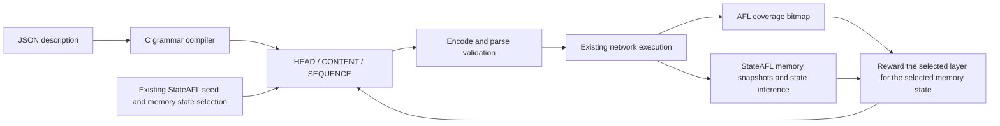

# Description-driven C mutation

`--generic-spec FILE` loads a `stateafl.generic-wire` version 1 JSON package
directly in StateAFL. `generic_wire.c` implements the bounded wire interpreter,
parser, encoder and field mutator. `generic_runtime.c` implements replay
records, message selection, sequence edits, response framing and correlation.
Neither module selects behavior by protocol name, invokes Python, loads
protocol-specific codecs or executes expressions as code. The existing
`--protocol-spec`/`--state-spec` route remains a separate legacy implementation.

Adding a protocol expressible with the primitives below requires a new JSON
description and replay seeds. The seventh-protocol acceptance fixture
demonstrates that path. Protocols requiring BER, conditional structures,
arrays, bitfields or session bindings beyond these primitives still require
general language extensions. The six industrial packages are scoped migration
subsets; see [their status](generic-wire-profile-scope.md) before use.

The existing YAML compiler and `run_protocol_campaign.py` emit and load the old
ICP-IR pair only. `build_generic_wire_profiles.py` is a six-profile fixture
migration, with selected messages, state edges and correlations supplied by its
own fixed tables. It does not translate the old state IR or all dependency
semantics. The passive native-layout format is a third, separate language.
See the [template format comparison](../protocols/templates/README.md).

The diagram below shows the implemented interfaces, not a claim that every
StateAFL state can reach them. In the reviewed source, the first region always
has a zero state count, while nonzero-state M2 selection rejects that count;
that path exits before generic mutation. Message-to-memory-state boundary
mapping also remains unresolved. See [current gaps](current-integration-gaps.md).



## Package structure

Use [fictional_protocol.json](../tests/generic-wire/fictional_protocol.json)
as a complete minimal example. The required top-level keys are `format`,
`version`, `protocol_id`, `transport`, `online`, `framing`, `messages`,
`states` and `limits`. `limitations` and `unsupported` document migration
gaps. Unknown executable keys are rejected. `online:false` fails at startup.

Each message declares an ID, `direction` (`request` or `response`), a positive
selection `weight`, a complete `example_hex`, and a `grammar`. The runtime
compiles and parses each example at load time. Request and response matching
are separate; a wire message matching multiple grammars in its direction is
rejected. Constants should distinguish message families explicitly.
The production loader and offline profile checker both cross-parse every
declared example against same-direction grammars and reject example ambiguity.
This moves known example failures to package loading. Neither finite check
proves that two grammars are disjoint for all possible wire values; actual
message matching continues to reject ambiguity.

The offline checker now also applies the native JSON input bounds before
decoding: at most 1 MiB of UTF-8 input, 65,536 nodes including object keys, and
value depth at most 96 with the root at zero. It rejects floating-point and
non-JSON numeric constants, out-of-range integers, duplicate decoded keys and
invalid Unicode scalars. These defensive checks do not extend the wire grammar.

A grammar is `{"kind":"struct","fields":[...]}`. Fields appear in wire
order and have unique IDs. The grammar consumes the entire message.

| Property | Executable meaning |
| --- | --- |
| `kind:"uint"` | Unsigned integer, `width` 1..8 bytes, explicit `byte_order:"big"` or `"little"`. |
| `kind:"bytes"` | Byte string with constant `length`, final `"rest"`, or a reference to an earlier unsigned length field. |
| `min`, `max` | Inclusive value bounds for integers; byte-count bounds for byte strings. |
| `role:"fixed"` | Preserve `expected` integer or `expected_hex` bytes exactly. |
| `role:"head"` | Integer selected by HEAD mutation. |
| `role:"content"` | Integer or bytes selected by CONTENT projection. |
| `role:"derived"` | Recompute an integer from an encoded byte size. |
| `values` | HEAD mutation suggestions inside integer bounds; these are not a parse-time enum restriction. |
| `derived` | `{"op":"size_of","target":"$message","add":-3}`, or a named field target. Counts encoded bytes. |

The byte string reference form is `{"ref":"length_field","add":0}`.
The referenced integer must precede the bytes so parsing can determine its
length. A derived `size_of` target may precede or follow the integer. All
arithmetic and output sizes are checked. A successfully encoded message is
parsed again through the same grammar before it is accepted.

TCP framing is a declared `length_field` with `offset`, `width` (1..4),
`byte_order` and signed `add`: frame bytes = field value + add. Responses may
arrive fragmented or coalesced. UDP uses `{"kind":"datagram"}`. The online
runtime bounds each message at 65,507 bytes and a serialized replay at
StateAFL's `MAX_FILE`. Limits also bound message count and repetitions.
The global TCP framing rule applies to request and response examples alike.
The C loader checks that the length field fits inside each complete example
and that its value plus `add` equals the example's byte length. This tightens
loading to match the offline profile checker; v1 has no per-direction framing
override. A custom package previously accepted with differently framed request
examples can now be rejected. This example check does not establish that every
grammar-accepted candidate obeys framing; the grammar must declare the needed
length dependency itself.
Request examples must also fit `limits.max_bytes` including their four-byte
replay prefix. Both loaders reject a package whose request template already
exceeds that budget. Response examples are not replay records and are not
charged against this request-sequence limit.
The host receive function currently concatenates UDP datagrams before calling
the generic runtime, which expects one datagram per call. Multiple datagrams in
one receive batch can therefore fail matching. The existing online fixture
does not model responses and does not validate this boundary.

## Three mutation layers and feedback

HEAD selects a declared integer and applies a suggested value, boundary,
bit flip or arithmetic edit. CONTENT projects bytes from the AFL candidate
only into the selected content field. Resizable byte strings repair their
declared size dependencies. Fixed constants and other field values are
preserved. Failed mutation/serialization returns a diagnostic and no output.

SEQUENCE inserts a declared request example, deletes a request, repeats one,
or reorders requests. It operates on `LE32(length) || wire` replay records;
the record prefix is never transmitted. The resulting request path must fit
the declared state graph and sequence budgets. The unchanged M1/M3 sequence
remains under StateAFL's existing selection logic.

`states.initial` names the initial semantic state. Each transition declares
`from`, `message`, `to`, and optionally `response`. Offline sequence checking
projects the declared outcome to decide whether a request sequence is legal.
During live execution a response-bearing transition waits for the actual
matching response. Response `correlate` entries compare integer `field` values
with a `source` field in the named `request`; they never fabricate observed
values. These description states are distinct from StateAFL memory state IDs.
The v1 live executor allows one outstanding response-bearing request per
session; a second send is rejected until the expected response is received.
It does not implement pipelining, retransmission recovery or server-issued
session-value bindings. Sequence message, repetition and byte budgets include
the captured M1 prefix; the integration separately enforces `MAX_FILE` for
the full M1/M2/M3 replay.
The retained M3 suffix is not included in the semantic graph or profile-budget
check. Its pre-send failure does not abort execution as a structured M2 failure
does. Consequently `valid` does not guarantee semantic validity of the full
M1/M2/M3 session. This limitation is separate from the full replay byte cap.

New generic statistics declare `stats_version:2`. `completed_responses` counts
pending requests completed by their expected response. `correlated_responses`
counts only completions with at least one applicable field equality rule checked
and all applicable rules passing. An expected response without rules can still
complete the request, but increments only `completed_responses`. Neither metric
counts individual field comparisons. Pending and semantic-state behavior is
unchanged by this accounting correction.

Historical statistics without `stats_version` have v1 semantics: their
`correlated_responses` includes completions without field rules. The report
writer distinguishes versions and does not infer field verification from old
counts. Unknown statistics versions remain uninterpreted.

`--protocol-schedule adaptive` uses the existing C scheduler for all three
layers. It keys weights by the selected StateAFL memory state, explores every
enabled layer, and rewards new queue entries, memory states, crashes, hangs,
new coverage tuples and newly observed hit-count buckets. A rejected candidate
gets an unsuccessful observation. Coverage credit requires delivery of the
whole structured M2; calibration/replay executions do not choose another
layer or produce duplicate candidate observations. Protocol response states
are not inserted into StateAFL's inferred memory-state graph.
Memory-state discovery is performed only after the ordinary coverage novelty
gate retains a candidate. The memory reward is therefore additional feedback
after that gate, not an independent retention path for memory-only novelty.
The recorded loopback run attributes every layer observation to state 0;
an injected nonzero-ID harness does not validate natural nonzero-state M2
selection. Adaptive scheduling is applied in havoc/splice; deterministic
stages keep the ordinary AFL candidates.

## Running and verification

Build `afl-fuzz`, prepare a replay corpus, and run against an instrumented
target with `--generic-spec FILE --mutation-mode valid --mutation-layers
head,content,sequence --protocol-schedule adaptive`. Use `-E` to enable
StateAFL's memory-state selection. Supply network transport and target
startup/timeout settings appropriate to that target. Omit legacy `-P`.

`valid` preserves the executable grammar constraints, not every semantic
requirement in a protocol standard. `hybrid` also executes ordinary raw AFL
mutations according to `--protocol-ratio`; `raw` bypasses structured mutation.
`near_valid` and `invalid` are rejected at startup for this grammar version.
Explicit `--protocol-fallback` permits raw execution after a rejected edit.

Run file-only C grammar/runtime checks with `make check-generic-wire`.
They use ASan/UBSan and include a new protocol, six profile subsets, malformed
input, size repair, field preservation, state sequencing and TCP correlation.
Run legacy integration regressions with `bash tests/protocol/run_all.sh`.

The bounded loopback acceptance command is:

```sh
python3 tests/generic-wire/run_live.py \
  --output /tmp/stateafl-generic-acceptance --seconds 12 --state-aware
```

This Python process only builds/starts the C target and fuzzer, then reads
saved evidence. The C target independently validates every received packet.
The report requires visible edits from every layer, no raw execution, real
coverage feedback and, with `--state-aware`, real memory-state feedback. It
does not measure an improvement over baseline AFL or establish industrial
protocol conformance. Comparative coverage claims require repeated equal
budget experiments on the intended industrial targets.

## Expressibility and rejection rules (G02)

### Common expressible intermediate semantics

To unify frontend representations without semantic loss, both the offline
schema checkers and the C grammar runtime (`generic_wire.c`, `generic_runtime.c`)
strictly restrict executable structures to the following lossless intermediate
primitives:

1. **Topology**: Strictly ordered flat sequence of fields (`kind: "struct"`).
2. **Scalars**: 1/2/3/4/8 byte unsigned integers (`kind: "uint"`) with fixed
   endianness (`big` or `little`).
3. **Byte slices**:
   - Fixed constant byte sequences (`role: "fixed"` or constant length).
   - Dynamic lengths referencing a strictly prior `uint` field with optional
     signed integer offset (`add`).
   - Suffix bytes consuming the remainder of the packet (`length: "rest"`),
     strictly allowed only on the final field of a struct.
4. **Length derivation**: Message total byte size (`size_of($message) + add`)
   or named field byte size.
5. **Deterministic state transitions**: Deterministic `(from, message) -> to`
   state triples with an optional matching expected response message.
6. **Correlation**: Exact integer equality between a request `uint` leaf and
   a response `uint` leaf (`request_field == response_field`).

### Mandatory unsupported construct rejection table

Any description file attempting to use structures outside this intermediate
contract must be explicitly rejected with an error diagnostic. The following
taxonomy of unexpressible constructs is enforced:

| Reject Code | Construct | Enforcement Point | Diagnostic |
| --- | --- | --- | --- |
| `UNSUPPORTED_GRAMMAR_KIND` | Grammar `kind != "struct"` (e.g. `array`, `union`, `choice`) | C `gw_compile` | `grammar must be struct` |
| `UNSUPPORTED_FIELD_KIND` | Field `kind` other than `uint` or `bytes` (e.g. `float`, `bits`, `tlv`) | C `gw_compile` | `invalid kind` |
| `UNSUPPORTED_PROPERTY` | Unknown properties (e.g. `when`, `repeat`, `guard`, `actions`, `script`) | C `nj_keys` | `unsupported JSON property` |
| `UNSUPPORTED_REST_POSITION` | `length: "rest"` not placed on the final field | C `gw_compile` | `rest must be final` |
| `UNSUPPORTED_REF_ORDER` | Length `ref` pointing to non-existent or later field | C `gw_compile` | `length ref must name earlier uint` |
| `UNSUPPORTED_TRANSPORT` | Transports other than `tcp` or `udp` (e.g. `sctp`, `serial`) | C `gr_load` | `invalid generic-wire package header` |
| `UNSUPPORTED_FRAMING` | Framing kinds other than `length_field` (TCP) or `datagram` (UDP) | C `gr_load` | `invalid generic-wire package header` |
| `UNSUPPORTED_ONLINE_SCOPE` | Multi-service profiles with unexpressible semantics setting `online: true` | C `gr_load` / tools | `description is offline-only` |

### Frozen fixture scope contract

Any byte field marked `fixed_*` in the six migrated protocol profiles represents
only a frozen example capture from a specific sample run. It **does not** constitute
structural decoding, semantic validation, or full-standard compliance for that
protocol. Switching `online: false` to `online: true` by simply toggling the boolean
flag or renaming a profile without implementing the missing primitives and passing
independent end-to-end verification is strictly prohibited.
