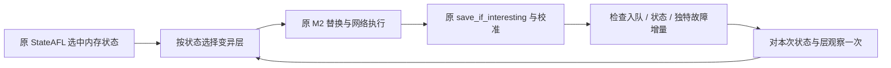

# 在线定向变异器与 StateAFL 的集成

本轮以 `feature/protocol-aware-integration-20261025` 为交付分支，合并远程
`origin/main` 后继续修改。三个 agents 分别静态审阅运行时、网络执行链及模型契约。
遵循 `AGENTS.md` 中暂缓测试的要求，本轮只审查源码及 Git 差异；未构建、未运行
测试、未启动目标服务。历史测试记录不代表本轮源码已通过回归。

## 真实响应与发送绑定

`receive_network_responses` 包装 `net_recv`，将每次追加的响应字节精确一次交给
`proto_after_response`。覆盖发第一条请求前的响应、常规收包、错误返回前已经收到
的部分字节以及结束时的 drain。TCP 分帧和不完整帧缓存仍由协议运行时负责；
返回码、原响应缓冲和 `response_bytes` 的使用遵循原网络流程。

`proto_before_send` 在有界私有副本上求解跨消息/响应/序号绑定。所有依赖和 wire
校验成功后才复制回调用方并记录 pending/cache；失败时调用方报文字节和会话状态
均不变化。依赖求值阶段仅读取缓存，实际缓存提交在最后的 `remember` 中完成。
这避免继承的 M1/M3 在允许原样发送的错误路径上带入半修复报文。

`near_valid`/`invalid` 消息同样经过逐条绑定检查；刻意破坏的报文被检查器拒绝，
由原发送路径忽略该拒绝并发送原始字节。原子性保证失败时不会留下半修复数据。
同序列中仍然有效的 M2 请求以及继承的 M1/M3 继续建立真实会话上下文。故意无效
请求不登记为正常 pending 请求，因此不将其响应关联率用于评判合法请求成功率。

Python `runtime_profile_signature` 纳入消息权重，与 C `equivalent_models` 的
等价约束一致；相同 wire 类别、字段和依赖但权重不同的别名在编译期明确拒绝。

新增的原子绑定、无效输入及模型权重负例仅为回归测试源码，尚未执行。

## 以原执行结果选择变异层

现有 `--protocol-spec`/`--state-spec` 命令可额外传入
`--protocol-schedule adaptive`。默认 `uniform` 保留原有均匀选层方式。
`adaptive` 仅在 havoc/splice 内选择结构化层，确定性阶段执行原 AFL 候选，避免
随机协议替换影响 effector map 和自动字典。需要直接进入随机阶段时可沿用 `-d`。
因此 adaptive 下的 `valid` 仅约束结构化候选；确定性阶段原 AFL 候选仍可能非法。
`raw` 与 adaptive 的组合在启动前明确拒绝，hybrid 比例和显式 raw fallback 仍适用。

`protocol_schedule.c` 保存最多 64 个准确匹配的 `uint32` 内存状态 ID；达到容量后
按最近使用顺序丢弃旧状态统计，不合并不同 ID。未启用 `-E` 时选中状态仍是原流程
的 0，因此所有尝试共享该上下文。协议语义状态不作为内存 ID 写入调度表。

每个新状态优先尝试尚未观察的启用层。之后各层的整数权重为：

```
16 + floor(240 * accumulated_reward / (15 * attempts))
```

每层均有最低权重 16，最大 256。单个候选的事件按是否发生计一次：新入队 +2、
新增内存状态 +4、独特 crash +8、独特 hang +1，总奖励不超过 15。
这些工程权重尚无性能实验支撑。每个状态累计约 1024 次观察后，将尝试和奖励
减半，保留近期结果的作用；全局诊断计数使用饱和加法防止溢出。



反馈只在 `common_fuzz_stuff` 中归属候选，内部 StateAFL 重跑、校准或 hang 确认
不会再次选择或记录尝试。首次执行完成全部结构化 M2 的发送后，才允许取得
发现奖励；未完整发送、候选构造/预算拒绝、中断和跳过均记录零奖励。raw fallback
只结算被拒绝的结构化尝试，不把 raw 执行所得归给该层。初始语料校准、导入
和直接重放不学习。网络发送完成不代表服务端语义上接受报文。

`protocol_mutations.jsonl` 的 `layer_feedback` 提供 `memory_state_id`、`layer_id`
及 `discoveries` 位掩码：1 入队、2 内存状态、4 crash、8 hang。`protocol_schedule.json`
保存全局事件计数、淘汰次数及各状态衰减窗口的尝试/奖励/权重；它是观察快照，
没有加载接口，重启或恢复时重新学习。`fuzzer_stats` 的 `protocol_schedule` 说明
当前策略。固定 `--random-seed` 在相同反馈序列下提供可复现的整数抽样；网络和
目标本身的非确定性不因此消失。

新增 `test_schedule.c` 覆盖层掩码、探索、状态隔离、奖励、LRU、计数溢出和固定
随机序列；`test_cli.py` 覆盖参数拒绝。完整协议脚本已加入独立调度器 sanitizer
检查入口。本轮没有执行这些测试或构建该入口。

## 当前边界

在线生产路径仍是 ICP-IR 与六种有界 codec。`native_layout_inspect_buffer` 的
通用布局入口提供只读检查，不能作为通用在线字段编辑器使用。不同 wire alias
的状态迁移冲突、模型文件整体原子发布、分布式导入和恢复格式仍需独立审阅。
当前修改不证明五个工业目标的互通、覆盖率提升或所有恢复场景正常。
