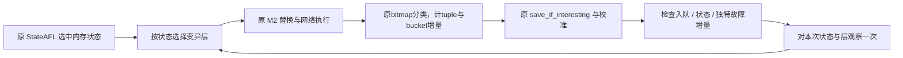

# 在线定向变异器与 StateAFL 的集成

交付分支为 `feature/protocol-aware-integration-20261025`，包含远程 `origin/main`
的修改。多个 agents 分别审阅模型、C 解释器、运行时和反馈链，并按用户后续要求
执行构建、sanitizer 回归及本地目标验证。下面分别记录实际通过的检查与尚未验证
的工业目标能力；历史结果不替代当前源码的回归。

## 真实响应与发送绑定

`receive_network_responses` 包装 `net_recv`，将每次追加的响应字节精确一次交给
`proto_after_response`。覆盖发第一条请求前的响应、常规收包、错误返回前已经收到
的部分字节以及结束时的 drain。TCP 分帧和不完整帧缓存仍由协议运行时负责；
返回码、原响应缓冲和 `response_bytes` 的使用遵循原网络流程。

`proto_before_send` 在有界私有副本上求解跨消息/响应/序号绑定。所有依赖和 wire
校验成功后才复制回调用方并记录 pending/cache；失败时调用方报文字节和会话状态
均不变化。依赖求值阶段仅读取缓存，实际缓存提交在最后的 `remember` 中完成。
这避免继承的 M1/M3 在允许原样发送的错误路径上带入半修复报文。

`near_valid`/`invalid` 消息同样经过逐条绑定检查；刻意破坏的报文被检查器拒绝，
由原发送路径忽略该拒绝并发送原始字节。原子性保证失败时不会留下半修复数据。
同序列中仍然有效的 M2 请求以及继承的 M1/M3 继续建立真实会话上下文。故意无效
请求不登记为正常 pending 请求，因此不将其响应关联率用于评判合法请求成功率。

Python `runtime_profile_signature` 纳入消息权重，与 C `equivalent_models` 的
等价约束一致；相同 wire 类别、字段和依赖但权重不同的别名在编译期明确拒绝。

原子绑定、无效输入及模型权重负例已纳入下文列出的 runtime、编译器回归。

## 以原执行结果选择变异层

现有 `--protocol-spec`/`--state-spec` 命令可额外传入
`--protocol-schedule adaptive`。默认 `uniform` 保留原有均匀选层方式。
`adaptive` 仅在 havoc/splice 内选择结构化层，确定性阶段执行原 AFL 候选，避免
随机协议替换影响 effector map 和自动字典。需要直接进入随机阶段时可沿用 `-d`。
因此 adaptive 下的 `valid` 仅约束结构化候选；确定性阶段原 AFL 候选仍可能非法。
`raw` 与 adaptive 的组合在启动前明确拒绝，hybrid 比例和显式 raw fallback 仍适用。

`protocol_schedule.c` 保存最多 64 个准确匹配的 `uint32` 内存状态 ID；达到容量后
按最近使用顺序丢弃旧状态统计，不合并不同 ID。未启用 `-E` 时选中状态仍是原流程
的 0，因此所有尝试共享该上下文。协议语义状态不作为内存 ID 写入调度表。

每个新状态优先尝试尚未观察的启用层。之后各层的整数权重为：

```
16 + floor(240 * accumulated_reward / (24 * attempts))
```

每层均有最低权重16，最大256。单个候选的队列/状态/故障事件奖励分别为新入队+2、
新增内存状态+4、独特crash+8、独特hang+1。状态以 has_new_bits(virgin_bits)
发现的本次新覆盖位置和已有位置新 hit-count bucket 直接加覆盖奖励：
min(8, 1 + floor(log2(new_tuples))) + (new_buckets > 0 ? 1 : 0)，单候选覆盖奖励
至多9。tuple数量是原始StateAFL bitmap中新到达的位置数，bucket数量是旧位置的新
分类数，两类互斥。总奖励上限24；真实计数在layer_feedback和全局调度快照中记录。
每状态累计约1024次观察后，学习历史折半以保留近期结果；总计数饱和加法。

覆盖采集挂在原has_new_bits路径，仅对完整发送后的当前执行开启，仅观察一次。
测量在原位图被AFL消费之前；之后普通入队和位图保存仍走原代码。StateAFL状态分析
和calibrate_case重放不会重复计数；timeout/crash专用virgin map、部分发送和拒绝
候选不记作正常结构化覆盖反馈。新bucket会驱动层奖励，即使它未造成新queue entry。
这直接联动AFL分类覆盖反馈，不等同按源代码边编号计数。



反馈只在 `common_fuzz_stuff` 中归属候选，内部 StateAFL 重跑、校准或 hang 确认
不会再次选择或记录尝试。首次执行完成全部结构化 M2 的发送后，才允许取得
发现奖励；未完整发送、候选构造/预算拒绝、中断和跳过均记录零奖励。raw fallback
只结算被拒绝的结构化尝试，不把 raw 执行所得归给该层。初始语料校准、导入
和直接重放不学习。网络发送完成不代表服务端语义上接受报文。

`protocol_mutations.jsonl` 的 `layer_feedback` 提供 `memory_state_id`、`layer_id`
及 `discoveries` 位掩码：1 入队、2 内存状态、4 crash、8 hang。`protocol_schedule.json`
保存全局事件计数、淘汰次数及各状态衰减窗口的尝试/奖励/权重；它是观察快照，
没有加载接口，重启或恢复时重新学习。`fuzzer_stats` 的 `protocol_schedule` 说明
当前策略。固定 `--random-seed` 在相同反馈序列下提供可复现的整数抽样；网络和
目标本身的非确定性不因此消失。

覆盖反馈在完整候选发送后，紧邻原 has_new_bits(virgin_bits) 消费前采集。每个
layer_feedback还写该候选的new_tuples/new_buckets，方便对账；protocol_schedule.json
相应保存全局coverage_events与饱和累计数。discovery位16表示存在直接覆盖新增，
裸位16不会产生覆盖奖励。

新增 `test_schedule.c` 覆盖层掩码、探索、状态隔离、tuple/bucket奖励、LRU、计数溢出
及固定随机序列；`test_feedback.c` 直接纳入 `afl-fuzz.c` 测真实 bitmap消费路径，验证
新tuple/bucket分类、重复位图、crash/session map隔离和一次调度归因。15项CLI测试覆盖
参数拒绝；完整协议脚本已加入scheduler和bitmap sanitizer检查。本次验证结果见下表。

本次验证覆盖了先前AGENTS.md中的暂缓测试约定，实际运行结果如下：

| 验证 | 结果 | 范围 |
| --- | --- | --- |
| 六协议描述检查 | 6/6通过 | schema、字段来源、消息/状态引用和一致性；没有编译执行器。 |
| test_model_completeness.py | 8/8通过，约33.4秒 | 全部71个fixture独立解码、31请求encoder声明、损坏长度/计数拒绝、ForwardOpen前提和生成可复现；编译并调用5个TCP C validator，不启动设备。 |
| generic native-inspection sanitized | 12,729项断言通过 | ASan/UBSan本地通用只读解释/观测/fixture API。 |
| 完整run_runtime_tests.py | 84 loader case、250随机模型、25,000随机报文、100,096运行时断言、13项原子绑定断言及会话/依赖harness通过 | C runtime ASan/UBSan/LSan；重新生成只在临时目录。 |
| scheduler ASan/UBSan | 通过 | 精确coverage reward、状态隔离、有界探索、LRU/decay、饱和及可复现RNG。 |
| StateAFL bitmap反馈ASan/UBSan harness | 通过 | AFL bitmap consumer的新tuple和bucket计数、重复消费和分类图隔离。 |
| native UDP/TCP/network sanitizer harness | 通过 | UDP原子发送、7000字节数据报、多数据报接收、TCP、LE32 replay及截断。 |
| afl-fuzz C 构建 | 通过 | 当前直接bitmap反馈版本链接运行时、调度器、五个TCP codec与native inspect C模块。 |
| 完整 tests/protocol/run_all.sh | 退出0，全部通过 | `tests/protocol/out/20261026-213134/`；compiler94、CLI15、templates14、model8、codecs22、multi-codec runtime13、analysis10、evidence22、description21、export1；包括上列scheduler、bitmap、runtime与network sanitizer。 |
| 五个TCP adaptive campaigns | 各5秒，均通过fixture检查 | 真实fuzzer/socket/C codec/响应绑定和逐候选反馈统计对齐；不是工业server。 |
| Modbus adaptive与uniform | 两边fixture通过；adaptive 96 executions / 3 paths / 0.41%，uniform 92 / 3 / 0.41% | 单种子短跑，不能证明提升。adaptive记录14个成功结构化序列、3个新tuple/45个新bucket；uniform选中并成功4次。 |
| 早期 BACnet -E试跑 | 失败，未进入变异 | loopback初始化时IPSM报告“No server states have been detected”；后续诊断发现200ms启动等待早于目标UDP bind，该次失败仍保留。 |
| 真实 BACnet 双请求 adaptive | 正常SIGINT退出0，ready后25.16秒 | HEAD/CONTENT/SEQUENCE成功构造5/6/5次；23次反馈含7次拒绝，新增13tuple/377bucket与快照对账；IPSM含0→1与1→1；单轮功能验证，不是对照收益证据。 |

五个TCP profile每个adaptive campaign都验证观察次数等于layer_feedback行数，并
验证调度器累计tuple/bucket值等于逐候选日志计数之和。五者都执行了三层的成功
变异，但单轮层覆盖不能证明所有描述消息/字段都有变异器，也不能证明覆盖优化有效。
带-E的Modbus fixture画出0->1和1->1 IPSM边；本次短时调度快照只命中state ID 0，
未验证多个内存状态各自学到不同策略。

该Modbus对照只有单种子/单短跑，coverage相同。当前证据证明direct bitmap反馈在线
消费和归属有效，没有证明adaptive相对uniform提高coverage。要声称提升，需在BACnet
Stack及多个目标上使用固定语料、构建、时长和StateAFL参数做配对多种子实验，记录
coverage曲线、唯一edge/tuple、StateAFL memory states及每层有效发送率。

## BACnet 启动预算与真实反馈复验

本机仪器化 Debug server 的独立 `execve` 到 UDP `bind` 约409ms，另一构建约489ms。
200ms等待的失败中，请求在监听建立前发出，导致没有响应、TLSH或IPSM。原始
Vendor_Name种子使用 `-D1000000 -t5000` 后可正常退出并取得0→1状态边；该轮是
legacy/raw，只证明原反馈与初始化可用。历史500ms/1000ms的seed04超时本轮没有
稳定复现，不能将其根因一并认定为已修复。两个BACnet驱动现在显式记录和校验
启动/总执行预算，见[实验参数](controlled-experiment-design.md)。

真实adaptive复验使用原Object_Name和Vendor_Name两条LE32记录拼成的单一序列，
启用`-E -d --mutation-mode valid --mutation-layers head,content,sequence
--protocol-schedule adaptive`，同样使用1s/5s预算。同步校准基线为45executions、
1path、1935个bitmap位置；结束为67executions、5paths，即变异阶段+22executions、
+4paths、+13位置。没有观测到crash/hang。三个层的成功候选不能等同语义接受；
23份发送capture包含StateAFL内部重放，也不能等同23次独立候选。

该轮23条`layer_feedback`与scheduler观察次数相等，累计13tuple、377bucket完全
对账；4次正奖励来自CONTENT和SEQUENCE，最终三层权重为16/29/23。全部观察仍归
state ID 0；`cycles_done=0`、`cur_path=0`表明短跑尚在首个`fuzz_one`，原状态选择
在其外层。IPSM中的非零状态不能因此被报告为已学习的非零调度上下文。

完整启动命令、生命周期、前后输入/模型/二进制哈希和反馈汇总保存于
`/tmp/stateafl-memory-context-20261026/{command,lifecycle,summary}.json`。fuzzer SHA256
为`a26124392d17bf928172e526c5e3931aae9d2e262150a1abb27274cee7f55085`，target SHA256
为`8b030a7fe5ef4d96cff35c1cbd5339a20cbc40084f07e5ae16ac887c8902bbdc`。

## 当前边界

在线生产路径仍是 ICP-IR 与六种有界 codec。`native_layout_inspect_buffer` 的
通用布局入口提供只读检查，不能作为通用在线字段编辑器使用。不同 wire alias
的状态迁移冲突、模型文件整体原子发布、分布式导入和恢复格式仍需独立审阅。
当前修改不证明五个工业目标的互通、覆盖率提升或所有恢复场景正常。
